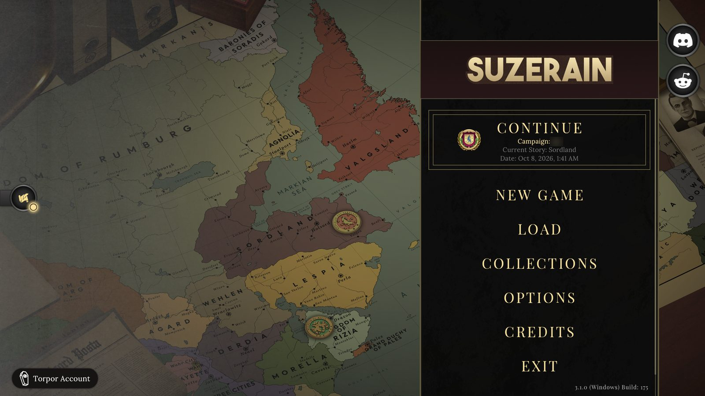
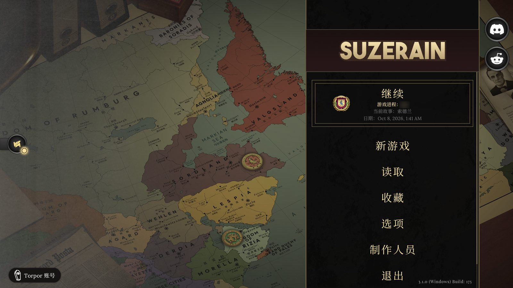
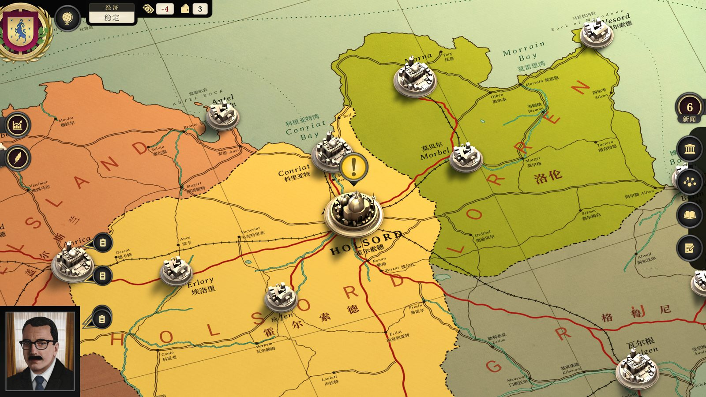
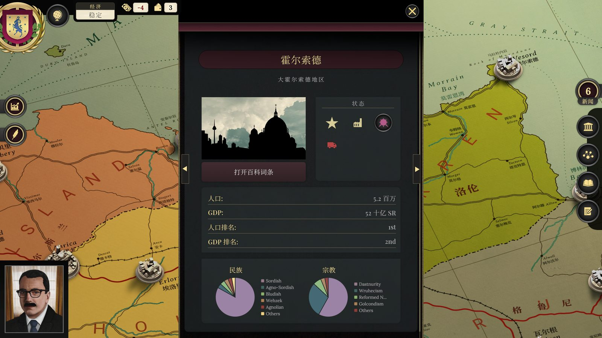

<div align="center">

# Suzerain 汉化补全计划

**把《Suzerain》里还剩下的英文，一处一处补齐——并且老实告诉你还差哪些。**


[](https://github.com/UCAS-ZTC/Suzerain-zh-CN-Completion/stargazers)

[效果](#效果) · [一眼看懂](#一眼看懂) · [包含什么](#包含什么) · [安装与还原](#安装与还原) · [为什么可以放心装](#为什么可以放心装) · [已知仍是英文的地方](#已知仍是英文的地方) · [参与贡献](#参与贡献) · [English](#english-summary)

</div>

面向 **Steam 版《Suzerain》**（AppID 1207650）的简体中文补全项目：补译资料库与成就，给 **48 张地图贴图**写上中文地名，并提供一个**带哈希校验、随时可还原**的图形安装器。

> **求求了，点个 Star！** 如果这个项目帮你把《Suzerain》补成了能读的中文，请点一下页面右上角的 **Star**。你的一个 Star 就是对我最实在的鼓励，也能让更多还在到处找完整汉化的玩家搜到这里。

---

## 效果

| 安装前 | 安装后 |
| :---: | :---: |
|  |  |
|  |  |

地图上英文原样保留，中文标在旁边，可以对照着看。下面是安装后的城市面板：人口、GDP 等字段已经是中文；民族 / 宗教图例里的名称按设计保留英文，原因见[“已知仍是英文的地方”](#已知仍是英文的地方)。



<sub>截图来自 2026-10-12 的实机测试（Windows 11，Steam 版 3.1.0 Build 175）；“安装后”是装上全部组件的状态，图中的存档名已打码。游戏画面版权归 Torpor Games 所有。</sub>

## 一眼看懂

- **补全，而不是重做。** 补译约 **560 个资料字段**（百科、新闻、地图卡片、决策、政策、报告、章节标题），另有对白脚本里拼进句子的约 **80 处**称谓 / 势力 / 地名，以及约 **230 个成就文件**。
- **纠正过时的旧译文。** 游戏英文在旧汉化之后又被改写过，旧中文对不上现版：**209 条**不同的文本（出现在 214 处）里与现版英文对不上的段落，按现版英文重译；另修正 **96 处**错字与重复字（每一处的前后对照都公开）。
- **地图上也有中文。** **48 张**地图 / 地名贴图、**1127 处**标注、**839 组**"英文 → 中文"对照：英文原样保留，中文标在旁边，可以对照着看。
- **界面和程序内文案。** **835 条**场景界面字符串（主菜单、设置、存档、战争界面、人物头衔），以及 **144 条**编译进程序的文案（确认弹窗、存档提示、屏幕通知等）。
- **每一步都能退回去。** 版本与哈希校验、先备份后覆盖、覆盖后再校验、一键还原；安装器从不使用 `-Force`。
- **一条命令复现，不分发任何游戏文件。** `python build.py --game "…"`：约 4 分钟用你自己的游戏和基础补丁构建全部 6 个包，并与维护者实测过的构建**逐字节对拍**（**307 / 307** 个文件一致，差一个比特都会指出是哪个文件）。
- **译文来源可复核。** 1373 条长句里 **98.4%** 与旧补丁的相似度低于 0.6；完全相同的只有 10 条，全是人名和职衔；相似度 0.8 以上的只有 3 条（其中一段话用词接近，文档里如实写明）。测量脚本和原始输出都在仓库里（[`docs/PROVENANCE.md`](docs/PROVENANCE.md)）。
- **测过，并且公开没测过什么。** 17 次实机启动、511 张截图、258 张画面的 OCR 残留英文普查；"仍是英文"和"没测过"的清单就写在本页。

## 为什么有这个项目

- Steam 商店页和 SteamDB 上，Suzerain 目前只列出英文（界面与字幕）。
  → [Steam 商店页](https://store.steampowered.com/app/1207650/Suzerain/) · [SteamDB](https://steamdb.info/app/1207650/patchnotes/)
- 开发商 Torpor Games 正在做**官方**简体中文，由玩家志愿者团队完成，目前（以商店页的语言列表为准）还没有上线。
  → [官方公告与进展](https://store.steampowered.com/news/posts/?appids=1207650&enddate=1753365792&feed=steam_community_announcements) · [r/suzerain 的进展帖](https://www.reddit.com/r/suzerain/comments/1lg44cn/update_on_the_suzerain_chinese_localization/)
- 在官方版本到来之前，玩家手里的社区汉化各有缺口。本项目只做一件事：**把缺口补上，并公开列出还没补上的。**

> 本项目是官方简中发布前的**过渡方案**，不是它的替代品，也不代表官方。
> 官方版本上线后，本仓库会评估兼容性，必要时归档并指向官方版本。

## 包含什么

安装器把下面的组件列在同一个窗口里，勾选想要的即可。**第一次建议只装"主汉化包"**，进游戏读一次档确认没问题，再逐个加别的。

| 组件 | 做了什么 | 规模 | 风险 |
| --- | --- | --- | --- |
| 主汉化包 | 资料库、对白库、成就、战争条目补译；过时译文重译；错字修正 | 258 个资源文件，约 205 MB | 低 |
| 地图中文标注包 | 地图与地名贴图旁加中文标注（并排标注，不替换原文） | 48 张贴图，1127 处标注 | 低 |
| 战争教程图片包 | 战争教程截图换成中文版 | 11 张图片 | 低 |
| 场景界面包 | 主菜单、设置、存档、战争界面等界面字符串 | 3 个场景文件，835 条字符串 | 中 |
| 程序内文案包（实验） | 编译进程序的整句 / 多词文案 | 144 条 | 高，可还原 |
| 程序内单词包（实验） | 零散常用词（是 / 否 / 首都 / 人口等） | 17 个词，必须先装程序内文案包 | 高，可还原 |

"推荐组合" = 主汉化包 + 地图中文标注包 + 战争教程图片包（三个风险低的）。

两个"实验"组件改的是游戏程序自带的字符串表，出问题的后果比换贴图严重（游戏可能起不来，但都可以还原）。另有一条**没有验证过**的提醒：装着程序内文案包期间新建的存档，名字可能被存成中文的"第 N 回合"。已有存档不受影响。

## 安装与还原

**本仓库不包含任何改过的游戏文件，也不包含旧补丁。** 你电脑上的补丁包，是用**你自己的游戏文件**、从**原出处下载的基础补丁（旧稳定版）**和本仓库的译文与脚本，**在本地构建**出来的；构建完再交给安装器安装。所以没有“下载补丁包”这一步，只有“构建”和“安装”两步。

### 第一步：构建补丁包

**准备：**

- Windows，Steam 版 Suzerain **3.1.0 Build 175**，游戏文件是原版（装过汉化包的话，先用安装器“还原”，或在 Steam 里“验证游戏文件的完整性”）；
- Python 3.11（实测版本；其他版本可以尝试，但构建器会警告“无法保证逐字节一致”）；
- 约 1 GB 空闲磁盘，能访问 GitHub（要下载约 63 MB 的旧补丁和约 25 MB 的字体）。
- 游戏目录在哪：Steam → 右键 Suzerain → 管理 → 浏览本地文件，资源管理器地址栏里的路径就是下面 `--game` 要填的。

```powershell
git clone https://github.com/UCAS-ZTC/Suzerain-zh-CN-Completion.git
cd Suzerain-zh-CN-Completion
python -m pip install -r requirements.txt
python build.py --game "D:\SteamLibrary\steamapps\common\Suzerain"
```

首次运行约 5 分钟（构建本身约 3.5 分钟）。构建器按顺序做四件事：

1. **预检**（只读）：Python 与依赖版本、游戏版本（`catalog.hash`）、将被替换的 **304 个游戏文件**是否都是原版。游戏目录从头到尾不会被修改。
2. **取基础补丁和字体**：基础补丁从它的 GitHub Release 下载，校验 SHA-256，再逐个校验解压出来的 34 个文件；字体（固定版本的 Noto Serif SC，画贴图用）从本仓库的 Release 下载，同样校验 SHA-256。
3. **构建 6 个包**（主包、地图地名、教程图、场景界面、程序内文案、程序内单词）。
4. **逐字节对拍**：把每个文件的 SHA-256 与维护者实测过的构建比对。全部一致会提示“全部通过：6 个包、307 个负载文件与已测试的构建逐字节一致”。

成品在 `out\`，安装器也已经放在里面。

<details>
<summary>构建遇到问题时</summary>

- **提示文件已被汉化补丁改过**：说明你的游戏里装过汉化包。先用安装器“还原”，或 Steam 里“验证游戏文件的完整性”，再重试。
- **提示游戏版本不对**：构建器只针对 3.1.0 Build 175。游戏更新后，需要等针对新版的适配。
- **下载基础补丁失败**（网络问题）：用浏览器自己下载那个 zip，然后 `python build.py --game "..." --base "zip 的路径"`。zip 的来源不限，构建器只认解压后每个文件的哈希。
- **字体下载失败，或提示“改用官方 2.003 版字体”**：构建器会自动退回官方 2.003 版并警告；这时校验会列出 3 个地图文件与实测不同，肉眼基本看不出区别，补丁照样可用。想与实测完全一致：用浏览器下载本仓库 Release `fonts-v1` 里的 `NotoSerifSC-VF.ttf`，放进 `assets\fonts\`，或加 `--font "路径"`。
- **输出路径太深的警告**：用 `--out D:\suz_out` 指向更短的目录。
- **提示有包与已测试的构建不一致**：常见原因是依赖版本或字体与实测不同（预检里会有对应警告）。这不一定表示补丁不可用，但这样得到的包没有经过维护者的测试。
- 重复运行是安全的：输出已存在且校验通过的包会被跳过；`python build.py verify` 只做校验；`--rebuild` 强制重做。

</details>

### 第二步：安装

1. **完全退出游戏。**
2. 打开 `out\Suzerain_CN_Plus_Installer_SteamWin_2026-10-10\启动安装器.bat`（安装器会在上一级文件夹里自动找到各组件）。游戏目录会自动识别；勾选组件，点「安装所选」。确认框里会列出实际的安装顺序（需要先装的依赖会自动加入）。
3. 进游戏，**读一次档**确认没问题。
4. **还原**：点「还原所选」或「全部还原」，游戏文件回到安装前的样子。最后的退路：Steam → Suzerain → 属性 → 已安装文件 → 验证游戏文件的完整性。

<details>
<summary>命令行 / 无窗口模式（高级用户、自动化测试）</summary>

```powershell
powershell -ExecutionPolicy Bypass -File Installer.ps1 -GameRoot "D:\...\Suzerain" -PacksRoot "D:\...\packs"

# 无窗口，按步骤执行；不加 -Yes 只显示计划不执行
powershell -ExecutionPolicy Bypass -File Installer.ps1 -Headless -GameRoot "..." -Scenario "install:maplabels;status" -Yes
```

组件代号：`plus`、`maplabels`、`tutorialimg`、`sceneui`、`programtext`、`programwords`。

</details>

## 为什么可以放心装

- **不改存档。** 主汉化包只替换 `.bundle` 资源文件，不改程序和存档。
- **版本不对就不动手。** 先校验 `catalog.hash`、`build-guid` 和每个要替换文件的哈希，对不上就拒绝，什么都不改。
- **先备份，再覆盖，再校验。** 备份在 `游戏目录\_patch_backup`，备份校验无误才覆盖，覆盖后再校验一遍。
- **还原只碰"现在正好是本补丁版"的文件。** 别的补丁、Steam 更新后的新文件一律不碰。
- **安装器从不使用 `-Force`**，所以这些检查在窗口里没有办法被绕过。
- **构建结果可复核。** 构建器只读你的游戏目录；每个输出文件都与实测过的构建逐字节比对，不一致会指出具体文件。
- **风险高的组件默认不在推荐组合里**，并且在窗口里标明。

<details>
<summary>测试情况（没有隐瞒）</summary>

**沙盒测试**（在游戏文件的拷贝里做，不碰真游戏）：

- 6 个组件做了完整的安装 / 还原流程，每一步之后逐个比对全部 **304 个文件**的哈希，结果都与预期一致；
- 安装器自带的回归测试 **96 项**，0 失败；
- 地图标注包另有 **26 项**沙盒检查，其校验脚本对成品逐文件检查（不是抽查）；每个组件都配有各自的校验脚本。

**实机测试**（2026-10-12，维护者的一台机器：Windows 11，Steam 版 3.1.0 Build 175，用维护者自己的存档；由 AI 驱动的自动化脚本执行，截图与日志均留存）：

- 17 次启动，511 张截图；
- 主菜单、设置页、读取窗口、暂停菜单，索德兰章节里的地图、百科、新闻、日志、笔记、国家 / 城市面板显示为中文；
- 装着场景界面包启动 7 次、每次都读档进入游戏，没有闪退；
- 游戏运行日志里没有发现与补丁相关的异常。

**没有测过的：** 新开一局、成就界面、里齐亚章节和战争界面（所以战争教程图片从没在游戏里看到过）、手动存档、窗口 / 无边框模式的「应用」按钮。
只在一台机器、一个游戏版本、一份存档上测过，其他环境的表现没有验证。

**构建器的验证**（2026-10-12，同一台机器）：

- 在全新的仓库副本里、清空所有相关环境变量，真实从 GitHub 下载基础补丁，用游戏目录构建：6 个包、**307 个负载文件**与维护者实测过的构建**逐字节一致**；
- 把输出副本里的单个比特改掉，校验能准确指出被改的文件；重复运行时已通过的包会被跳过；
- 仓库公开之后，又从 GitHub 重新克隆了一份，让构建器真实下载旧补丁和 Release 里的字体（两者都做了 SHA-256 校验）并完整构建：约 4 分钟，仍是 **307 / 307** 一致。字体被改一个比特、下载地址不存在、地址未配置这三种情况，构建器都会拒绝坏文件并退回官方 2.003 版（各测过）。
- 构建器产出的包在沙盒里重跑了安装器的无窗口回归测试（H0 到 H15，75 项检查），0 失败；窗口部分（G1 到 G5）用的是同一个 `Installer.ps1` 和同样的负载文件，这次没有重跑；
- 构建与测试期间游戏目录里没有任何文件被修改（2273 个文件的最新修改时间早于所有构建运行，只发生了读取）。

**与已交付的包相比有什么不同：** 只有 8 个**非负载**文件不同——每个包的 `patch_manifest.json`（构建时间戳；部分包多一段旧哈希历史）、地图地名包的 `README.txt`（交付版多一段“实机验证后”的说明）、场景界面包与教程图包的 `install.ps1`（交付版是旧模板，构建器输出多 4 行无副作用的提示）。游戏里实际被替换的文件完全相同。

**逐字节一致的前提：** 依赖版本（`requirements.txt` 锁定）和字体（固定版本，作为 Release 附件提供，构建器自动下载并校验，说明在 `assets/fonts/README.txt`）与实测一致。实测过：字体换成 noto-cjk 官方 2.003 版，53 张地图贴图里有 3 张各有一个字形附近的几十个像素不同，对应 3 个 bundle；教程图不受影响。

</details>

## 已知仍是英文的地方

2026-10-12 用 OCR 扫了装全之后的 258 张实机画面，再逐个核对。**只覆盖打开过的画面**（主菜单、设置、读取、暂停、索德兰章节的地图 / 城市 / 国家面板和弹窗）；里齐亚章节、战争界面、成就、新开一局、对白与百科的大段文字不在这次普查范围内。

<details>
<summary>展开完整清单</summary>

- **能改，但这一版没改**（要先在游戏里验证过才敢放进包里）：日期时间的显示格式；城市 / 国家弹窗上的 `Open … Information` 按钮；收藏页与制作人员页的少量标题；宗教饼图图例的最后一项 `Others`。
- **改不了**（程序运行时现拼的）：排名后面的序数词（1st / 2nd）；国家关系与军力的等级名；读取窗口里的存档名与存档类型。
- **故意没改**：设置页下拉框的取值（On / Off / High / Default）；国家 / 城市面板里民族、宗教图例的名称——译成中文会让地图界面整体消失（实机测试发现，已回退，见更新记录）。
- **不属于文案**：主菜单背景里那张装饰地图上的字（大部分已加标注）、报纸刊名与报头、游戏标志与版本号、缩写。

</details>

## 常见问题

**Steam 更新游戏之后呢？** 版本检查会变红，安装器拒绝操作——这是有意的。先在 Steam 里"验证游戏文件的完整性"，再等针对新版本的适配。把 Suzerain 的自动更新设为"仅在启动游戏时更新"，可以减少被悄悄覆盖的机会。

**提示 `Unexpected file hashes detected`？** 说明文件既不是原版，也不是已知补丁的版本（被 Steam 更新过，或被别的补丁改过）。先"验证游戏文件的完整性"，再重新安装。不要加 `-Force`。

**看到方块、乱码、文字超出框？** 请到 Issues 提交，附截图和位置。

**要不要去给游戏打差评？** 请不要。Torpor Games 是一个全职七人的小团队，补丁出的问题请来这里反馈，而不是算到游戏头上。

## 工作原理（给开发者）

- **资源包文字**：用 UnityPy 读取 Addressables 资源包，只替换文字字段，不改结构；游戏代码按英文解析的字段（如国家关系、军事条件结果的枚举值）和地图标记里的内部查找名保持英文。
- **程序内字符串（IL2CPP metadata v39）**：直接改 `global-metadata.dat` 的字符串字面量表，**保持文件大小与各段偏移不变**；对每条字面量先判断有没有"暗号"用法（同一字面量同时被当作字典键、比较值或对象名使用），有则不改。
- **贴图标注**：RapidOCR 定位英文地名（含倾斜角度）→ 逐张目视校对 → 用 Noto Serif SC 写中文，字号与倾斜角随英文走向，光晕取局部底色；DXT 贴图**只重压缩被写字的 4×4 块**，其余块原样保留，大地图直接原位改写。
- **安装器**：不重写安装逻辑，只调用每个组件自带的 `install.ps1` / `restore.ps1`；用哈希链判断每个组件的当前状态并排好依赖顺序。
- **可复现构建**：所有生成器的路径都由环境变量给出，`build.py` 只做编排：预检 → 取基础补丁 → 按依赖顺序构建（地图地名包建在主包之上，程序内单词包建在程序内文案包之上）→ 与 `data/expected_outputs.json` 逐文件比对 SHA-256。原本要扫描整个游戏目录才能得到的清单（贴图位置、教程 bundle 位置）换成随仓库提供的小型定位数据（针对 Build 175，使用前先做哈希校验）；英文地名的 OCR 结果也随仓库提供，所以玩家构建时**不需要** OCR 环境。画贴图用的字体是固定版本，不在仓库里，由构建器从 Release 下载并校验（下载不了时退回官方 2.003 版，并在校验里如实列出差异）。
- **验证**：逐文件校验、沙盒全流程比对、实机截图 OCR 普查——每一项都能复现。

## 本项目的贡献

- **内容**：见上文"一眼看懂"。
- **工程**：带版本与哈希校验的可回退安装器；依赖自动排序；无窗口回归测试；**可复现构建器**（一条命令、逐字节对拍、不分发任何游戏文件）。
- **研究**：IL2CPP metadata v39 的字面量字节级改写；贴图只重压缩被写字的块；并排标注方案。
- **验证**：沙盒 + 实机 + OCR 普查，并且把"没测过"和"仍是英文"写在最显眼的地方。
- **透明**：实测译文与旧补丁的重合度并公开方法和原始输出（[`docs/PROVENANCE.md`](docs/PROVENANCE.md)）；构建结果与已测试构建的差异，连非负载文件的 8 处不同也逐条写明。

一次值得写出来的自我纠错：第 1–3 版把地图标记里的"国家宗教 / 民族名称"（如 Sordish、Wruhecism，共 413 处）也译成了中文。**实机测试发现**这会让进入地图界面后整套界面都不显示；第 4 版把这 413 处改回英文并写进了更新记录。发现问题、修正、公开——这比假装没有问题重要。

## 参与贡献

- **求求了，点个 Star**：最省力的支持方式，点一下就行。它能让更多还在找完整汉化的玩家看到这个项目；也欢迎转给同样在玩 Suzerain 的朋友。
- **报错字 / 术语 / 崩溃**：Issues 里选对应模板，附截图和位置（条目名越具体越好）。
- **提交译文改进**：欢迎 PR。请只提交**你自己翻译、或有明确授权**的内容。
  **请不要提交来自网络流传的未授权 / 泄露文本。**这会让整个仓库面临下架。
- 译文放在哪里、怎么自查、改代码的要求，见 [`CONTRIBUTING.md`](CONTRIBUTING.md)。
- **译名**：沿用现有译名；现有写法在 `data/tm/` 和 `data/maplab/names_*.py` 里，改之前请先搜一下。

## 致谢与声明

- 游戏《Suzerain》及其全部素材版权归 **Torpor Games** 所有。本项目与 Torpor Games 无关联，未获其授权或背书。请先购买正版。

**来源链条**（本项目站在别人的肩膀上）：

1. **原作者：虾饺面z**（[百度贴吧原帖](https://tieba.baidu.com/p/10208533522)）——最初的 Suzerain 汉化补丁。
2. **SweeneyJun**（[Suzerain-CN-Stable-SteamWin](https://github.com/SweeneyJun/Suzerain-CN-Stable-SteamWin)）——游戏更新后借助 AI 对上一版补丁做了适配，整理出"稳定版"。他在 README 里明确说明自己不是原作者，也不代表原作者立场。
3. **本项目**——在稳定版之上补全。

本项目**不包含、也不再分发**上面两位的补丁文件：构建器在你的电脑上直接从稳定版的 GitHub Release 下载它（文件不经过本仓库）并校验 SHA-256，作为构建的输入。稳定版仓库目前没有声明许可证，贴吧原帖的使用条款我们也没能核实；本项目没有获得两位作者的明确许可。如果你是其中一位、对此有任何意见，请在 Issues 里告诉我们，我们会立即处理。

本项目的译名沿用了原补丁已有的译名（人名、地名、职衔），以保证与已有汉化一致。译文与旧补丁的重合度见 [`docs/PROVENANCE.md`](docs/PROVENANCE.md)。

- 使用的第三方组件及其许可见 [`NOTICE.md`](NOTICE.md)：Noto Serif SC（SIL OFL 1.1，作为 Release 附件提供，许可全文与来源说明在 `assets/fonts/`）；UnityPy、Pillow、numpy、scipy、etcpak、texture2ddecoder、lz4、brotli（用 pip 安装）；RapidOCR（仅维护者生成 OCR 数据时使用）。

**AI 辅助声明**：本项目的脚本、测试、文档与新增译文由 **Claude Sonnet 5.5** 协助完成；维护者负责需求、方向决策、授权与最终取舍。实机测试由 AI 驱动的自动化脚本在维护者的机器上完成，截图与日志均留存。整个项目共消耗约 **7 亿 token**（维护者统计）。特别感谢 Claude Sonnet 5.5。AI 起草的译文难免有疏漏，欢迎通过 Issues 指正。

如果权利人要求移除任何内容，我们会立即处理，请在本仓库的 Issues 里留言。

**维护者**：[UCAS-ZTC](https://github.com/UCAS-ZTC)

**最后再求一次：如果这个补丁让你少看了一句英文，请点个 Star，求求了。**

## 许可证

- **代码与工具**（`build.py`、`tools/`、`installer/`、`docs/`）：[MIT](LICENSE)。
- **译文**（`data/tm/`、`data/maplab/names_*.py`，以及几个脚本里的“英文 → 中文”对照表）：[CC BY-NC-SA 4.0](LICENSE-TRANSLATIONS.txt)。可以自由使用、修改、转载，但要署名并说明改动，不得商用，衍生作品要用同样的许可。
- **字体** Noto Serif SC：SIL OFL 1.1（构建时下载，不在仓库里）。
- **游戏素材**和构建出来的补丁包：不在上述许可范围内。补丁包含有你自己游戏文件的改动版本，请只在自己的电脑上使用，不要上传或转发。
- 逐项范围与第三方声明见 [`NOTICE.md`](NOTICE.md)。

---

## English summary

**Suzerain zh-CN Completion** — a community stopgap that completes Simplified Chinese coverage for *Suzerain* (Steam, Windows) until the official localization ships. It adds missing translations (Codex, news, map cards, achievements, UI strings), 1,127 Chinese map-label annotations across 48 map textures, and a GUI installer with hash verification, backups and one-click restore. Tested on game version 3.1.0 Build 175; the installer refuses to touch files if the version does not match. Not affiliated with Torpor Games. Known gaps and untested areas are listed above. Code is MIT, the translations are CC BY-NC-SA 4.0 (see `NOTICE.md`). If this saved you from a half-translated *Suzerain*, please, please give the repo a star.
